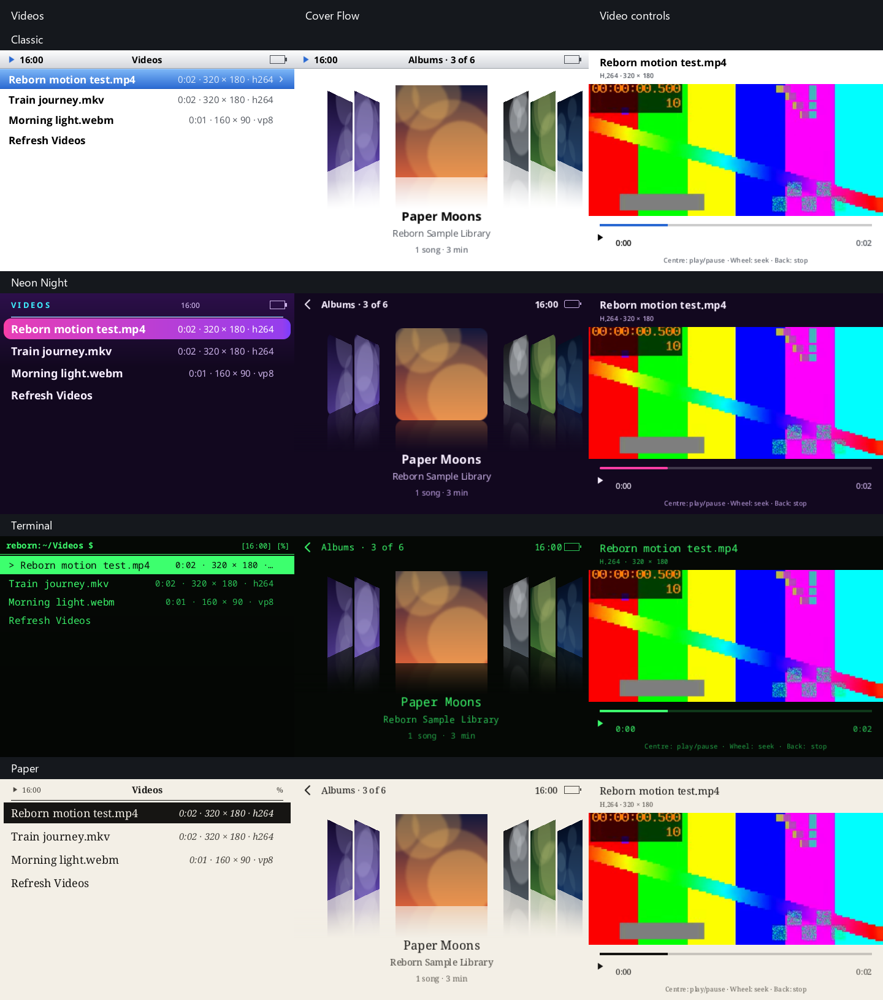
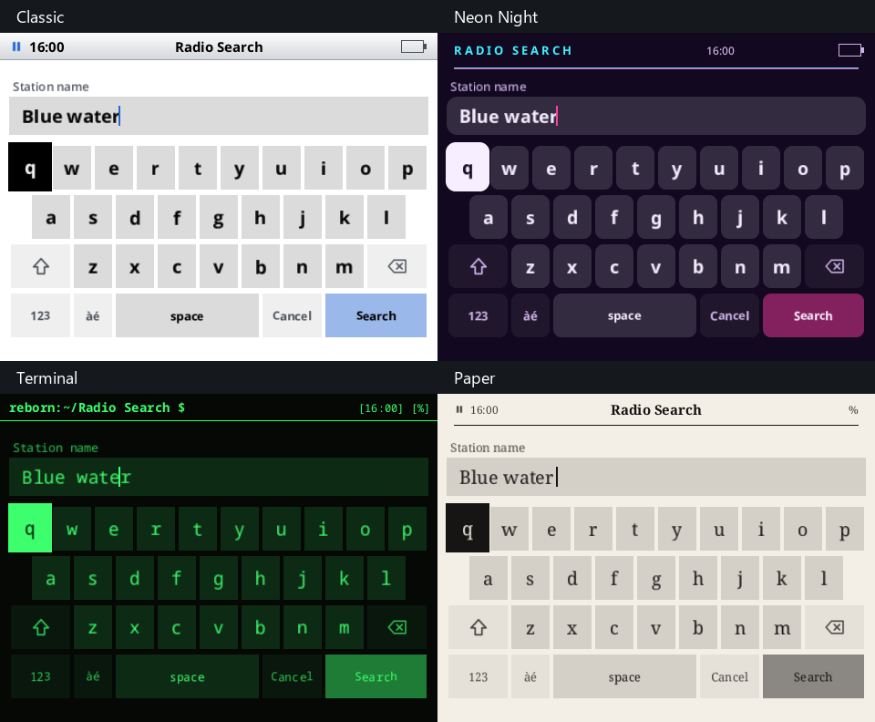

# Video and unified-skin host validation

Source candidate, 2026-11-08. This records host verification, not a qualified Y2 image or hardware release.

## Results

| Check | Final result |
| --- | --- |
| Rust 1.99.0 `cargo fmt --all -- --check` | PASS |
| `RUST_TEST_THREADS=1 cargo test --workspace --locked --offline --no-fail-fast` | PASS: 790 passed, 0 failed, 10 ignored across 33 test/doc-test targets |
| `cargo clippy --workspace --all-targets --locked --offline -- -D warnings` | PASS, zero warnings |
| Y2Linux `tools/development/platform-gate.sh` | PASS: GATE OK, including ARMv7 type check, tests, goldens, record compatibility and Reborn contract |
| Y2Linux local-video component policy tests | PASS, 4 tests |
| Y2Linux storage integrity fixture and deterministic expired deadline | PASS, 2 targeted tests |
| Real software EGL/GLES production-video upload/shader test | PASS, included in the workspace run; UBSan enabled |
| Four-skin production UI previews | PASS, reviewed Classic / Neon Night / Terminal / Paper sheets |
| Supported production ARM build entry point | NOT BUILT: `Y2_BUILDROOT_OUTPUT` is not configured |
| Physical Y2 video playback | NOT TESTED: no device connected |

The test environment is a Windows-hosted QEMU x86_64 Linux VM, Debian development libraries,
FFmpeg 9.0.2 and Mesa software EGL/GLES. Workspace, decoder, GLES and preview checks used TCG;
final platform gates used WHPX hardware acceleration with the same disk, source and toolchain.
The target rootfs, DRM scanout and Bluetooth hardware are
not represented by that environment. The platform gate's ARMv7 type check is distinct from an ARM
player/image build. The normal supported cross-build script was attempted and reported its missing
production Buildroot output.

Disposable test fixtures use tmpfs. Golden-case diagnostics used two workers with restricted
CPU affinity during a concurrent application build; affinity was restored when compilation
finished. The commit gates cap fixture concurrency through `Y2_GOLDEN_WORKERS` on the
emulated host, without a competing workspace run. Every case and assertion remains enabled; this is host test scheduling, not
a Y2 performance measurement.

The final platform golden run completed 24 test methods with `OK (skipped=1)`. The existing
root-peer daemon conversation requires `unshare -r`, unavailable on this host kernel; that
environment skip remains explicit. Record compatibility lost or retyped zero fields, and the
Reborn contract check covered 483 cases.

## Coverage

The player test binary passes 117 tests, with two existing live-service tests intentionally ignored.
The full workspace totals appear in the results table. Coverage includes the existing music,
output-reconfiguration, gapless/crossfade, artwork, playlists, audiobook and persistence tests.

New coverage exercises:

- Internal/SD video discovery, extension filtering, symlink avoidance and cancellation.
- Actual changing H.264 pictures, bounded RGBA sizes, metadata and ordered timestamps, matching
  decoded audio duration, MP4/MKV/WebM admission, seek after EOF, cancellation and corrupt-input
  descriptor cleanup.
- Audio-clock presentation, paused picture stability, clearing old pictures on seek, bounded queue
  cancellation, job replacement and worker quiescence before sleep.
- Suppression of a second gapless audio pass for video when the saved music preference is Repeat
  All, without changing that preference or ordinary music handoffs.
- Atomic revision-checked resume state and separate checkpoint files for video and the music queue.
- Physical control actions, optional legacy typography, skin font metrics, palette switching, cover
  shapes and Classic's light Cover Flow/keyboard backgrounds.
- Real production GLES texture coordinates, spatial picture detail, frame updates, texture reuse,
  dimension changes and rejected invalid dimensions on a surfaceless software EGL context.

All sixteen shipped skin packages load through the production compiler. The screenshots compare
Classic, Neon Night, Terminal and Paper with the production UI, a decoded synthetic picture and
procedural album covers. Filenames in the demonstration rows are illustrative.

The architecture guard has two scoped explanations for own-process `/proc` reads: a test-only
file-descriptor inventory and the explicit decoder qualification tool's peak RSS. These use the
guard's existing test/diagnostic allowlist mechanism. The code-quality baseline records only
improvements; no ratchet limit is increased.

The repository-wide documentation checker finds 192 pre-existing Y2Linux link/heading problems in
unchanged historical pages, mostly references to the removed Python platform implementation.
None originate in changed Linux pages, and this contribution removes no link target.

## Decode measurements

These observations are from an emulated, busy x86_64 VM with the host's complete FFmpeg package.
They do not establish playable frame rates or memory consumption on the reduced ARM package.

| Synthetic input | Codec | Decoded pictures | First / last PTS (ms) | Largest RGBA picture | Process peak RSS |
| --- | --- | ---: | ---: | ---: | ---: |
| MP4, 320×180, 2 s | H.264 | 40 | 0 / 1950 | 518,400 bytes | 50,264 KiB |
| MKV, 320×180 | H.264 | 40 | 0 / 1950 | 518,400 bytes | 50,376 KiB |
| WebM, 160×90 | VP8 | 10 | 0 / 900 | 518,400 bytes | 46,524 KiB |

The probe reported approximately 7.74, 11.44 and 17.93 decode frames/s respectively under TCG;
`real_time_playback_test` is false in each record. There is no real-time or battery claim.

The source-picture admission ceiling is 414,720 pixels, the area of 720×576. Converted pictures
are at most 480×360 RGBA (691,200 bytes). The channel holds two messages, the UI may own a future
picture and one being uploaded, and the worker may own one being converted or sent. FFmpeg's
reference frames, audio buffers, loaded libraries and GPU storage are additional memory. Native
allocation failures return errors where recoverable; system OOM termination needs device testing.

## Earlier failures and corrections

An initial run against the VM's FFmpeg 7 yielded 90 passed, 20 failed and 2 ignored tests. It
included the pre-existing FFmpeg 9 filter-API requirement, the changed square-cache expectation,
and timing-sensitive tests. The VM was upgraded to FFmpeg 9 and the cache test was updated to
verify the intended skin-time shaping boundary.

A parallel FFmpeg 9 run aborted in a real-time audio continuity test while compilers were active.
The same audio test passed with compilers suspended. Final workspace execution uses serial test
threads and isolates the player audio tests from compiler load. The artwork test now waits for
actual channel publication rather than racing its unread count; the exact deduplication assertion
is retained. The sample-rate agreement test retains exact PCM frame counts and completion events,
with a fifteen-second hang guard instead of treating emulator throughput as a product deadline.
Production audio deadlines were not relaxed.

The cancellation fixture now signals that its TERM handler is installed before the test cancels
it; the cancellation-latency assertion remains. Home-menu expectations include Videos, and the
boot-handoff source guard follows the renderer's mechanical module move. The VM's loopback
interface was enabled for local radio fixtures. An existing radio startup wait and the platform's
scratch-storage benchmark failed under competing emulator load and passed in isolation. Its
ten-second fixture budget also failed in the serial full gate; it now has a sixty-second budget
while retaining all measurement, checksum, live-data and scratch-cleanup assertions. A new
deterministic expired-deadline test checks timeout errors, absent measurements and scratch cleanup.
Production benchmark deadlines are unchanged.
The final workspace runs serially, without a competing compiler. `--no-fail-fast` preserves full workspace
coverage after any failure; no test target is excluded.

The first full golden comparison failed on the monitor's elapsed `supplicant_events.since_s`
window (`0.0` recorded versus `0.1` or more on the emulated host). Its comparison now requires
the same numeric type and a finite non-negative duration, while retaining exact counters,
unrelated values and missing-field checks. Regression coverage verifies those boundaries; the
expected golden files were not re-recorded. Final source review also caught a Repeat All/gapless
handoff that could pre-open a second video-audio pass. The controller now suppresses video
handoffs without changing music preferences, with a dedicated regression test.

A subsequent golden run exposed host-dependent report inputs: local timezone, DEFLATE bytes from
zlib versus zlib-ng, and SQLite's backup writer-version stamp. Fixtures now supply fixed UTC+1
and retain three tiny synthetic archives with the original upload hashes. Export comparison
canonicalizes only SQLite header bytes 96–99, the [writer-library version](https://sqlite.org/fileformat.html#write_library_version_number);
schema, user version and data pages remain exact. Regression tests verify the retained archive
contents and that other SQLite bytes still cause differences. No expected golden JSON was changed.

The last TCG golden run had one failure in 23 tests, plus one existing user-namespace skip:
`collect-reborn`'s first snapshot sometimes took longer than its one-second warmup, legitimately
adding a growth observation where the recorded fast-host result had none. The VM was switched
to WHPX acceleration; this fixture and the full gate were rerun with unchanged assertions.

The first accelerated run exposed another fixture assumption: a DNS timestamp of `1` is still
fresh during the first 420 seconds after host boot. The stale-cache input now uses a timestamp
421 seconds before the current monotonic clock. A regression test covers both early and mature
host uptime; the golden still requires the same DNS-expired state and reason.

Clippy found an existing BlueZ reply helper below its test module. It was moved unchanged above
the module. Visual QA found Classic's dark Cover Flow opt-out and a double keyboard palette pass;
the manifests and native-keyboard adapter now have regression coverage.

## Remaining qualification and review

No production ARM player/image build or physical Y2 result is claimed. On-device A/V drift,
sustained decode/drop rates, Bluetooth latency and output changes, SD removal, repeated sleep/wake,
GPU recovery, long/variable-frame-rate media, low-memory behavior and battery use need the paired
image and hardware evidence before release.

The initial target formats are MP4/M4V H.264/AAC, MKV H.264 with an available audio codec and WebM
VP8/Opus. Silent videos, subtitles, rotation metadata, alternate audio selection and video playlists
are outside this implementation. Paused seeking chooses the resume point; pictures advance again
on playback. HEVC, VP9 and AV1 are not added to the target package.

Upstream has no plugin host or official extension ABI. The app controller is an isolated built-in
boundary, with the existing transport, storage and renderer as owners. The maintainer's decision
about admitting it now or moving it behind a future plugin host remains open (issue #41). The
paired Y2Linux codec/verifier and ratchet changes must be coordinated with this application change.
